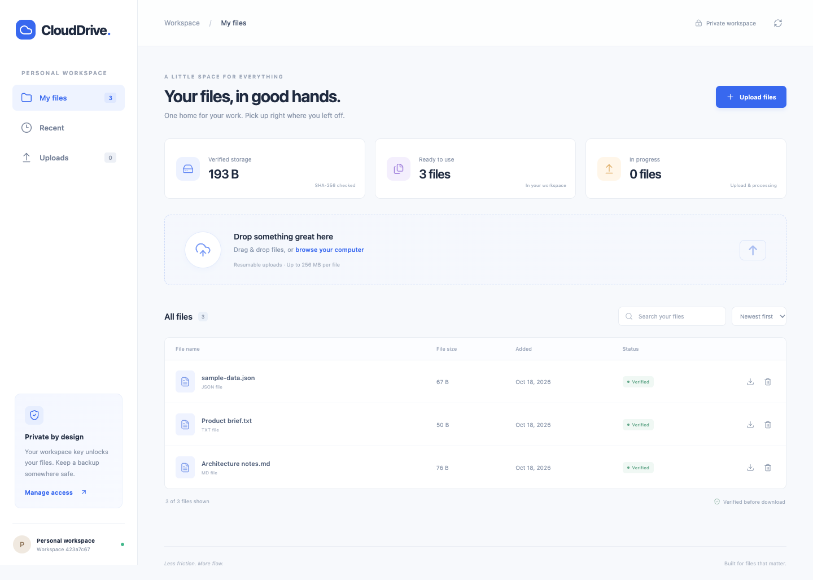
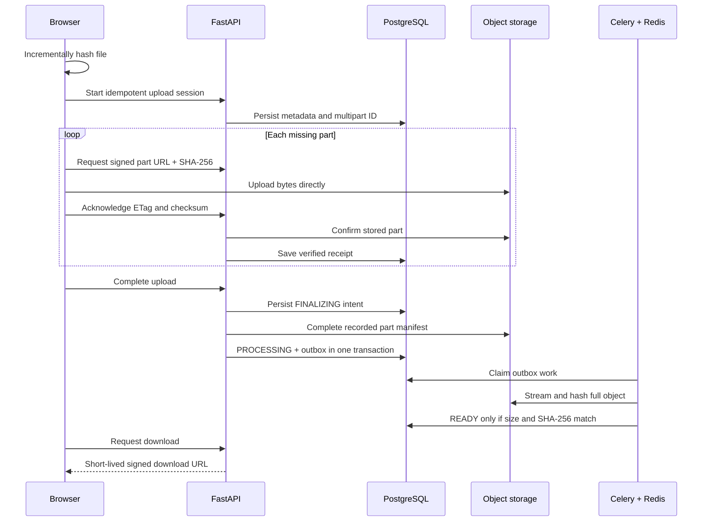

# CloudDrive

[](https://github.com/maneesh-bijjula/clouddrive/actions/workflows/ci.yml)

A private file workspace with resumable multipart uploads, direct object-storage transfers, and asynchronous integrity verification. Built with **FastAPI, PostgreSQL, S3 APIs, Celery, Redis, and TypeScript**.



## What it does

- Upload files directly from the browser to private object storage using signed multipart requests. The default inclusive limit is **5 GB (5,000,000,000 bytes) per file**, with 8 MiB parts and up to three concurrent part transfers per file.
- Pause an upload, reload the page, and resume by selecting the same file. A cancellable browser worker hashes the file in bounded chunks; full-file SHA-256 identifies the original content; confirmed parts are reused. Lost upload acknowledgements are reconciled against storage.
- Verify each part with SHA-256 at the storage boundary, then independently stream and verify the entire file in a Celery worker. Downloads stay blocked until verification passes.
- Browse, search, sort, inspect checksums, preview UTF-8 text, download, and delete files. The interface works on desktop and mobile.
- Keep processing requests in a PostgreSQL outbox during broker outages. Recover lost messages and expired worker claims, and prevent duplicate or stale workers from overwriting newer state.
- Export and import a private workspace access key to reopen the same workspace in another browser. Only the key hash is stored in PostgreSQL.

## Measured large-file workflow

A local packaged-browser run uploaded **5,000,000,000 bytes**, paused/reloaded after three acknowledged parts, resumed without resending those parts, and verified all **597 parts** plus the full downloaded SHA-256. Active transfer windows totaled **111.11 s**; the full fixture-to-cleanup runner took **350.73 s**, including both browser prehashes and the download check. This was **one file, one attempt, on local MinIO**; it does not establish live AWS behavior or ten-upload concurrency. [Exact scope, environment, commands, timings, and evidence](docs/sprint-2.md).

## Measured recovery

The versioned recovery matrix passed **20/20 named cases in each of three complete local passes (60/60 attempts)**, with matching source/worker/download bytes and SHA-256, one logical result/object, and no multipart leaks. Coverage includes browser interruptions, actual process kills, broker-message loss, dependency outages, and explicitly labelled boundary exceptions. This used small deterministic fixtures on local MinIO; Linux CI separately passed 20/20 once. [Fault definitions, timing, exact scope, commands, and permanent evidence](docs/sprint-3.md).

## Run locally

Requires Docker with Compose v2. All application ports bind to the loopback interface.

```bash
git clone https://github.com/maneesh-bijjula/clouddrive.git
cd clouddrive
docker compose up --build -d --wait
```

Open **[localhost:8090](http://localhost:8090)**. The first build also compiles the pinned MinIO community security release from its official source; allow a few minutes.

| Service                 | Local port | Purpose                                           |
| ----------------------- | ---------- | ------------------------------------------------- |
| FastAPI + web interface | 8090       | Application and metadata API                      |
| PostgreSQL              | 5435       | Upload sessions, file metadata, processing outbox |
| Redis                   | 6382       | Celery task delivery                              |
| MinIO S3 API            | 9000       | Private multipart object storage                  |
| MinIO console           | 9001       | Local storage administration                      |

The Compose credentials are for local development: PostgreSQL `clouddrive / clouddrive`; MinIO `clouddrive / clouddrive-local`. Data persists in named volumes. `docker compose down` stops the stack while retaining those volumes.

Use **Manage access → Export access key** to back up your workspace before clearing browser storage. On narrow screens, use the key icon in the top bar. The exported JSON contains a secret: anyone holding it has full access to that workspace.

## Upload and processing flow



### Recovery and consistency

Upload initiation uses a client-generated request ID unique within its workspace. Reusing it with different metadata returns a conflict. Part checksums cannot change within a session; acknowledgements must match the bytes, size, checksum, and ETag reported by object storage.

Completion records a durable `FINALIZING` state before completing the multipart upload. If storage completes successfully but the database update fails, a retry checks the unique object metadata and length and continues without completing the upload twice. The scheduler also retries abandoned finalizations after 30 seconds.

The transition to `PROCESSING` and creation of an outbox row share one PostgreSQL transaction. The dispatcher publishes before deleting that row. A crash between those steps can publish a duplicate; processing is idempotent. Workers use 90-second claims, renew them during streaming, and condition final writes on the current claim. Periodic reconciliation republishes processing work whose message was lost or whose claim expired. Transient task failures retry with backoff; exhausted retries become visible failures that can be retried from the UI.

Deletion first commits a durable `DELETING` intent, revokes the worker claim, and removes pending processing work. The file immediately disappears from browsing and download authorization. Cleanup then aborts any remaining multipart upload, removes the object, and commits `DELETED`. A retry or the scheduler completes interrupted cleanup after 30 seconds, including a crash after object removal. A stale worker cannot restore a deleted file.

PostgreSQL and object storage do not share a transaction. A failure immediately after creating a multipart upload can leave an unreferenced incomplete upload. Configure incomplete multipart expiration on the storage provider and monitor storage usage. MinIO manages stale multipart uploads through its own server settings. An explicit `NoSuchUpload` from storage marks the session `EXPIRED`; transient service errors leave it retryable. Choose **Restart upload** and reselect the original file. Its full SHA-256 must match before the browser replaces the expired session with a new request ID. Saved browser request IDs are scoped to the workspace, and deletion retires the corresponding ID so the same file can be uploaded again.

## Development

Requires Python 3.12 and Node.js 24 or later.

```bash
python3.12 -m venv .venv
source .venv/bin/activate
pip install -r requirements-dev.txt
npm ci
docker compose up -d --wait postgres redis minio
cp .env.example .env
npm run build
uvicorn clouddrive.api:app --host 127.0.0.1 --port 8090
```

In two additional terminals with the virtual environment activated:

```bash
celery -A clouddrive.worker:celery worker --loglevel=INFO --concurrency=2
celery -A clouddrive.worker:celery beat --loglevel=INFO --schedule=/tmp/clouddrive-beat
```

`npm run dev` serves the frontend at port 5173 with an API proxy to port 8090. The API serves the compiled frontend directly after `npm run build`. Database migrations run at API startup under a PostgreSQL advisory lock, and applied migration checksums are verified.

Existing `.env` files retain their configured limit: update `CLOUDDRIVE_MAX_FILE_BYTES=5000000000` to enable the new 5 GB default in development. MB/GB use decimal bytes; MiB/GiB use powers of 1024.

Configuration uses `CLOUDDRIVE_` environment variables; see [.env.example](.env.example) and [config.py](clouddrive/config.py). The internal S3 endpoint must be reachable by the API and worker. The public endpoint must be reachable by the browser **with the same hostname used when signing**. Storage CORS must permit the browser origin, `PUT`, and `x-amz-checksum-sha256`, and expose `ETag`.

## Tests

The separate [named recovery matrix](docs/sprint-3.md) exercises 20 distinct recoverable faults with explicit injection proof and source/download integrity checks. Its three-pass release denominator is 60 attempts; development rehearsals and ordinary test counts are reported separately.

The implementation passes **39 unit tests, 50 real-service integration tests, and 20 browser workflows**. The browser workflows also pass against the packaged Docker stack. See [verification notes](docs/verification.md) for the tested failure cases and a repeatable broker-outage check.

Unit tests run without infrastructure:

```bash
python -m pytest -q
```

The integration stack has separate ports and ephemeral data. Cleanup refuses to run unless the database ends in `_test` and the bucket ends in `-test`.

```bash
docker compose -f compose.test.yaml up --build -d --wait
python -m pytest --integration -q
npm run build
npx playwright install chromium
npm run test:browser
docker compose -f compose.test.yaml down
```

Activate the virtual environment first. On a machine with Google Chrome installed, `PLAYWRIGHT_CHANNEL=chrome npm run test:browser` uses that browser instead. The browser test runner starts and stops its own API, Celery worker, and scheduler against the isolated services; keep port 8090 available. `PLAYWRIGHT_EXTERNAL_SERVER=1` runs the same browser tests against an already running application. The expiry browser test uses `scripts/expire-test-upload.py`, which refuses databases/buckets without the test suffixes. Use the dedicated packaged verification configuration and environment overrides in [verification notes](docs/verification.md).

Coverage includes multipart checksums, resumed uploads, duplicate initiation/completion, cross-workspace isolation, corrupt-content rejection, private downloads, deletion, broker publish failure, expired worker claims, and recovery after S3 completion followed by a failed database update. Browser tests exercise real Celery processing, byte-identical downloads, safe text previews, access-key transfer, mobile layout, and pause/resume across reloads. CI runs the browser suite against both host processes and a separately built packaged Docker stack, then uploads test artifacts. Recovery coverage includes a real SIGKILL after object deletion, forced PostgreSQL row-lock races, expired multipart restart, stale workers, all file operations under another workspace key, and an upgrade from populated baseline metadata. These regression counts are separate from the named recovery matrix.

Completed work and evidence are recorded in the [Sprint 1](docs/sprint-1.md), [Sprint 2](docs/sprint-2.md), and [Sprint 3](docs/sprint-3.md) reports. Remaining concurrency and operations work is tracked in [the completion plan](docs/completion-plan.md).

## Operating scope

This repository runs a complete local storage workflow. Integration and browser verification use **MinIO**, an S3-compatible service. Ordinary CI uses small fixtures and does not by itself verify target-size transfer or concurrency capacity. The opt-in [large-file procedure](docs/sprint-2.md) records separate evidence. No live AWS behavior or concurrency capacity is asserted by the small-fixture tests.

Workspace keys are bearer credentials stored in browser local storage. There are no user accounts, role permissions, access-key rotation, or recovery if every copy of a key is lost. Upload URLs last 15 minutes; download URLs last 60 seconds and remain usable until expiration. Use HTTPS, restricted storage credentials, authentication controls, rate limits, backups, and operational monitoring before exposing a deployment beyond a trusted environment.

The file browser searches and sorts the latest 200 files; workspace totals cover all active files. Resume requires reselecting the original local file. Text previews are limited to 2,000 characters; unsupported binary content remains downloadable after integrity verification. Integrity verification checks byte consistency and does not scan for malware or establish that a file is safe to open.

Application code is licensed under [MIT](LICENSE). The separately built MinIO service is licensed under [GNU AGPLv3](https://github.com/minio/minio/blob/RELEASE.2025-10-15T17-29-55Z/LICENSE).
